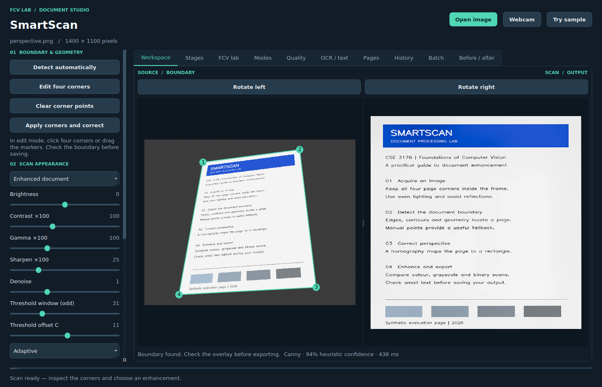

# SmartScan 2 · offline document and OCR studio

A complete **CSE 3176: Foundations of Computer Vision** mini-project using Python, OpenCV, PySide6 and local Tesseract OCR. It includes all the optional features listed in the project brief.



## Install on Windows (Python 3.11 or 3.12)

Extract the entire project ZIP. Open PowerShell in the **SmartScan** folder containing `main.py`:

```powershell
py -3.12 -m venv .venv
.\.venv\Scripts\python.exe -m pip install -r requirements.txt
.\.venv\Scripts\python.exe main.py
```

Replace `-3.12` with `-3.11` if needed. Using the executable directly avoids PowerShell activation-policy changes. After setup, `run_windows.bat` launches the app.

**For OCR and searchable PDFs, install Tesseract 5 with English language data once.** Follow [docs/OCR_SETUP.md](docs/OCR_SETUP.md), then use OCR / text → Check OCR setup. You can select `tesseract.exe` directly in the app. No GPU, API key or cloud account is required. Normal processing is offline after installation. This is a source distribution rather than a bundled Windows executable.

Linux/macOS:

```bash
python3.12 -m venv .venv
.venv/bin/python -m pip install -r requirements.txt
.venv/bin/python main.py
```

Ubuntu OCR: `sudo apt install tesseract-ocr tesseract-ocr-eng`. A minimal Linux desktop may also need Qt system libraries such as `libxcb-cursor0`, `libxkbcommon-x11-0` and `libegl1`. Do not install multiple OpenCV wheels in one venv; the project uses the headless OpenCV wheel because Qt provides the GUI.

## Complete feature list

| Feature | Where to use it |
|---|---|
| Document detection and manual corner editing | Workspace: Detect automatically, Edit four corners, Apply corners and correct |
| Perspective correction and five enhancement modes | Workspace: appearance controls; Update enhancement |
| Actual intermediate images | Stages tab |
| Histograms, filters, morphology, K-means, HSV and Hough | FCV lab tab; 18 independent experiments |
| Input/output quality diagnostics | Quality tab; explicit heuristic methodology |
| Local OCR, language and layout selection | OCR / text: Check setup, Extract text |
| Extracted text preview, copying and TXT export | OCR / text |
| Searchable PDF and ordinary image PDF | Save image / PDF; OCR / text searchable export |
| Multipage scanning and persistent ordered queue | Add scan to document; Pages tab |
| Automatic page numbering | Pages: enabled by default for PDF export |
| Document rotation | Workspace: Rotate left / Rotate right, in 90-degree steps |
| Manual boundary adjustment | Drag existing corner markers or clear/reselect four points |
| Drag-and-drop upload | Drop one image to scan; multiple images to batch-import |
| Persistent scan history with OCR-text search | History: auto-saved scans, snapshots, restore/delete |
| Batch processing with cancellation and per-file report | Batch: Choose images and scan; cancel between pages |
| Before/after comparison slider | Before / after: drag divider or slider on aligned rectified images |
| Image/stage export, webcam and recent images | Sidebar controls and header |

## Demonstrate the project

1. Click **Try sample**. Inspect the green boundary and the corrected output. Show grayscale, Canny, closing, contour candidates and perspective correction in Stages.
2. Edit/drag corners and apply them. Use a real phone photograph as well; clipped content cannot be reconstructed.
3. Choose Colour, Grayscale or Black-and-white and click Update enhancement. Original scan preserves only the warp; the other modes use the controls. Sliders are applied by the update button, not continuously.
4. Generate all five modes in Modes. In Before / after, move the divider to compare the corrected input with its enhancement in the same geometry. The original photograph remains visible separately in Workspace.
5. Show Histogram, Equalize, CLAHE, K-means, Hough and filter experiments in FCV lab. These do not change the saved scan.
6. Rotate the page if needed. In OCR / text, check setup and extract text. Preview/copy/save it and export a searchable PDF. Open the PDF in a viewer and search for a visible word.
7. Add the scan to the document. Open/capture another image and add it too. In Pages, reorder them, preview a page, and export a numbered searchable PDF. The queue survives app restarts.
8. In History, search by title or recognized text, reopen a snapshot, or add one to the document. History stores processed scans and OCR locally; it does not copy original photographs. Use Save current snapshot after changing an enhancement if you want to archive that version.
9. Choose several photos in Batch or drop multiple files. Select an output parent folder. A new run subfolder receives PNG files, OCR TXT/searchable PDF files when enabled, and `batch_report.json`. Successful scans enter history; available slots up to the 20-page queue cap are filled. Failed boundaries can be opened by double-clicking their result row for manual correction.
10. Show the no-document or partial-page fixture. Automatic scan export is unavailable until a valid manual boundary is supplied. Explain the quality score's limits rather than treating it as OCR accuracy.

## CLI

```powershell
.\.venv\Scripts\python.exe main.py --cli sample_images/perspective.png outputs/scan.png --stages outputs/stages
.\.venv\Scripts\python.exe main.py --cli sample_images/perspective.png outputs/searchable.pdf --searchable --number-pages
.\.venv\Scripts\python.exe main.py --cli sample_images/shadows.png outputs/scan.png --ocr --mode "Black-and-white"
.\.venv\Scripts\python.exe main.py --cli my_photos outputs/new_batch --batch --ocr
```

Manual corners are JSON in original pixel coordinates, for example:

```powershell
.\.venv\Scripts\python.exe main.py --cli sample_images/perspective.png outputs/manual.png --corners '[[390,150],[1030,65],[1140,980],[230,1030]]'
```

CLI codes: `0` success, `1` invalid input/export/OCR configuration, `2` missing boundary or a batch with non-success rows. A requested searchable export never silently falls back to raster PDF.

## Project structure

```text
SmartScan/
  main.py, requirements*.txt, run_windows.bat
  src/
    image_processing.py, document_detection.py, perspective_correction.py
    enhancement.py, quality_analysis.py, pipeline.py
    export.py                # Atomic image/TXT/raster and searchable PDF export
    ocr.py                   # Local Tesseract subprocess and structured OCR results
    history.py               # SQLite snapshots and persistent ordered queue
    batch.py                 # Cancellable independent file processing
    gui.py                   # Core visual workspace, workers and camera
    advanced_gui.py          # Shipping interface: OCR, history, pages, batch
    gui_widgets.py           # Registered before/after wipe widget
    cli.py
  sample_images/             # Deterministic scenes and geometric truth
  tests/                     # CV, export, real OCR, persistence and GUI checks
  tools/                     # Fixtures, evaluation, report and diagram builders
  docs/                      # Report, setup, algorithms, viva and measured evidence
  assets/fonts/              # Embedded report/PDF fonts and upstream license
  outputs/
```

## Tests and evaluation

Install Tesseract with `eng` data before the full suite. The tests invoke the real engine rather than mocking OCR results.

```powershell
.\.venv\Scripts\python.exe -m pip install -r requirements-dev.txt
$env:QT_QPA_PLATFORM="offscreen"
.\.venv\Scripts\python.exe -m pytest -q --junitxml=docs/test_results.xml
.\.venv\Scripts\python.exe tools/evaluate.py
.\.venv\Scripts\python.exe tools/evaluate_optionals.py
Remove-Item Env:QT_QPA_PLATFORM
```

Linux/macOS uses `QT_QPA_PLATFORM=offscreen` before a command. See `docs/TESTING.md` and the JSON/XML evidence for executed scope. Synthetic geometric scenes are not a real-camera benchmark. Only English OCR is evaluated here. `tools/generate_samples.py` regenerates the scene fixtures. The source has been tested on Linux with Qt offscreen; native Windows rendering and physical webcam behavior need local validation.

## Local data and bounds

History lives in `%LOCALAPPDATA%\SmartScan` on Windows, `~/.local/share/smartscan` (or XDG_DATA_HOME) on Linux, and `~/Library/Application Support/SmartScan` on macOS. It contains processed PNG snapshots, OCR PDF caches and `history.sqlite3`. Search covers the latest 500 snapshots. Delete a history item to remove its snapshot and queue references. Clearing the document leaves history intact. Set `SMARTSCAN_DATA_DIR` to choose a different directory; tests always use isolated temporary data.

Inputs are capped at 40 megapixels, detection at 1000 px longest side, lab/stage previews at 1200 px, and final output at 2600 px. Documents contain at most 20 pages. Processing uses a background worker; cancellation takes effect between batch pages. OCR has a 90-second per-page timeout. Hardware speed is not guaranteed.

## Limitations

The detector selects one geometric candidate and may confuse paper with other rectangles. Heavy shadows, glare, background similarity, occlusion, folds and severe blur can require a better photograph or manual corners. A planar homography does not fix curved pages or lens distortion. The true physical page ratio cannot be recovered from an uncalibrated view using edge lengths alone.

OCR is intended for printed text. Handwriting, complex layouts, unusual fonts and poor imagery can cause transcription/reading-order errors. Rotation is manual. A high engine confidence or heuristic image score is not validated accuracy. PDF text-search results inherit OCR errors; copied/corrected text outside the app does not alter the embedded text layer. No cloud fallback or silent model download occurs.

The project implements every optional feature named in the brief; it does not claim automatic text orientation, PDF input parsing, handwriting recognition or nonplanar page dewarping. These are separate possible future extensions.

## Documents

- `docs/OPTIONAL_FEATURES.md` — complete feature-to-implementation map and walkthrough.
- `docs/OCR_SETUP.md` — engine installation, languages, workflows and errors.
- `docs/FCV_GUIDE.md` — technique mapping, equations, parameters and limitations.
- `docs/SmartScan_Project_Report.pdf` and `docs/PROJECT_REPORT.md` — report and editable source.
- `docs/VIVA.md`, `docs/TESTING.md`, `docs/IMPLEMENTATION_PLAN.md` — evaluation preparation and evidence.

Third-party libraries retain their licenses. Review Qt/PySide6 distribution obligations before packaging a binary. No credentials are used by this project.
