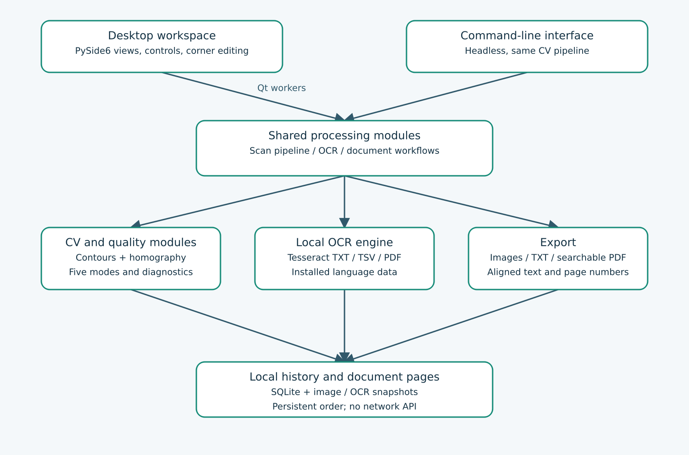
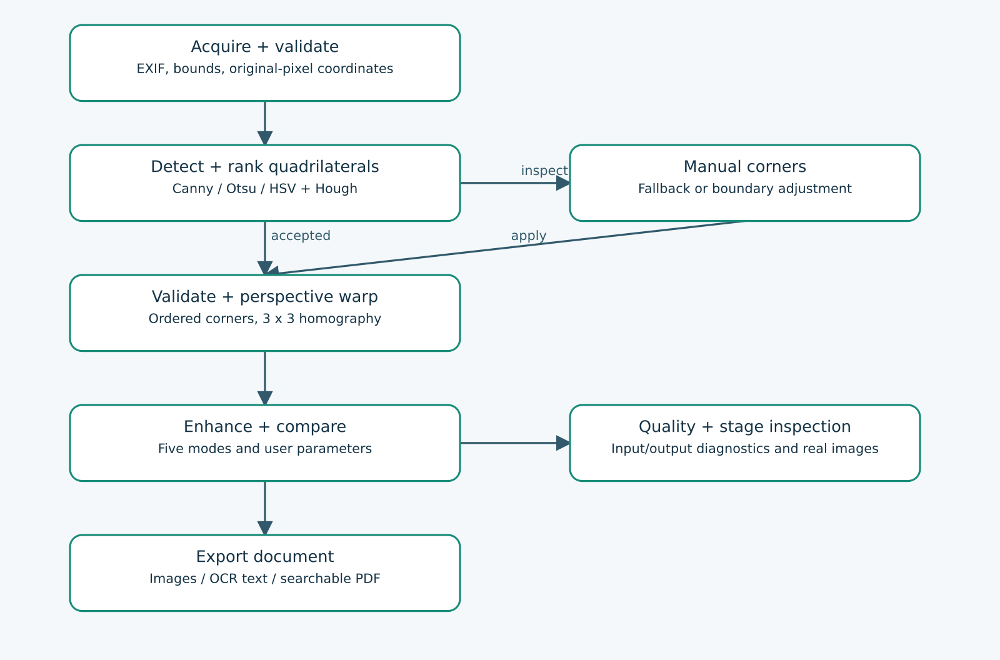
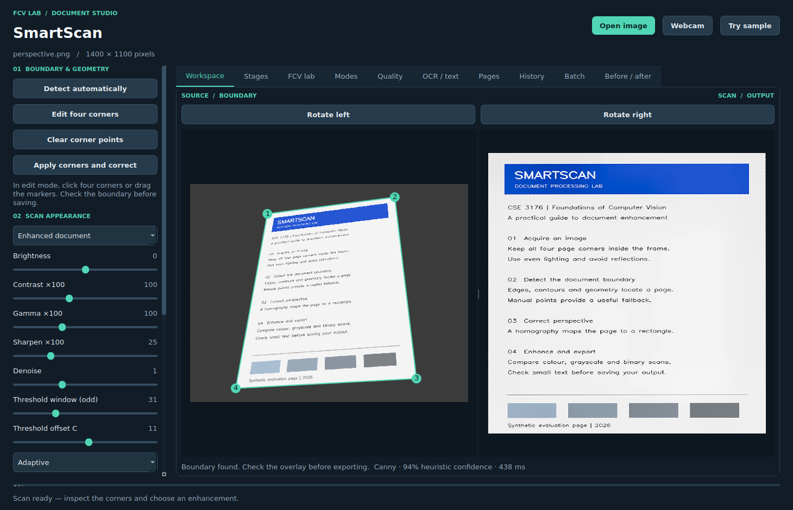
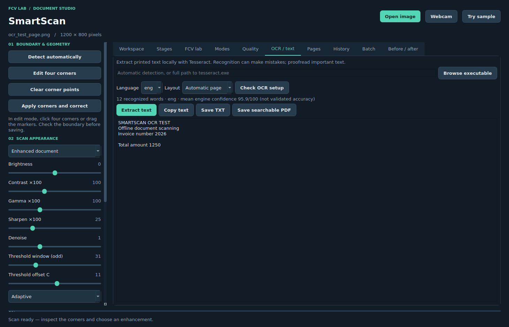
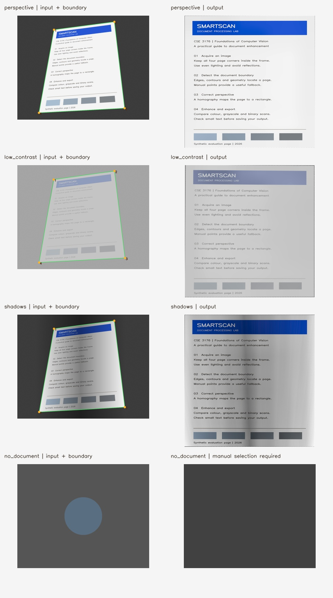

CSE 3176 - FOUNDATIONS OF COMPUTER VISION

# SmartScan

Intelligent Document Detection, Enhancement and Perspective Correction Using Computer Vision

MINI-PROJECT REPORT

Academic Year 2026 | V Semester | Section A | Batch 2028

| Team member | Registration number |
| --- | --- |
| Madaka Shreyaj Naidu | 240962594 |
| Advait Balachandar | 240962600 |
| Dipen Batharaju | 240962574 |

B.Tech. in Computer Science and Engineering (AI & ML)

School of Computer Engineering
Manipal Institute of Technology
Manipal Academy of Higher Education

Implementation and test evidence dated 2 November 2026


<!-- page break -->

## 1. Abstract and project objectives

### Abstract

SmartScan is an offline document-scanning application that detects a visible page, corrects its perspective, improves its presentation and exposes the computer-vision operations behind the result. It uses Python and OpenCV for processing and PySide6 for a desktop workspace. A multi-strategy detector combines edge contours, threshold masks, colour evidence and supporting line intersections. Validated four-corner correspondences define a homography that rectifies the page into a rectangular crop. Five scan modes offer colour, grayscale, binary and enhanced output with user-controlled parameters. A manual corner editor provides a fallback when automatic inference is uncertain.

The application includes actual intermediate images, an independent FCV technique laboratory, transparent quality diagnostics, local OCR, searchable PDF export, a persistent multipage document manager, page numbering, rotation, batch processing, scan history and a registered before/after slider. Validation uses deterministic generated scenes with known geometric boundaries, unit checks and offscreen GUI integration tests. These results establish behavior on the supplied fixtures; they do not establish accuracy on an unrestricted real-camera dataset.

### Introduction and problem statement

Photographs of documents may contain a tilted page, perspective distortion, shadows, low contrast, noise or blur. Manual correction is repetitive, and aggressive image enhancement can reduce readability. The problem is to produce a usable scan while making the underlying FCV techniques understandable and allowing the user to correct errors.

### Objectives

- Acquire a local image or camera frame and identify a plausible document boundary.

- Rectify a planar document using validated four-point geometry.

- Offer readable, adjustable scan modes without forcing every algorithm into one chain.

- Display original/output views, intermediate stages and interpretable quality metrics.

- Export images and PDFs locally, handle failure safely and support an FCV lab demonstration.


<!-- page break -->

## 2. Background and system architecture

The project follows classical image-processing methods rather than a trained document model. Edge and region methods supply complementary evidence: Canny can retain an edge across intensity changes, while threshold masks can recover a bright region even if its edge is locally weak. Contour simplification identifies geometric candidates, but geometric validity alone cannot prove that an object is paper. The manual editor is therefore a deliberate component of the design.

Histogram equalization and CLAHE redistribute contrast; Gaussian, median and bilateral filters suppress different noise patterns; thresholding separates foreground and background. A planar homography supplies the geometric correction. OpenCV documentation provides the operation semantics [1-4], while the Qt threading APIs support the responsive frontend [5]. This is background on the methods used, not a comparative literature benchmark.

Figure 1. Modular application architecture. GUI and CLI share the same processing pipeline.



Pure processing modules operate on NumPy arrays. The GUI submits loading, CV and export operations to a Qt thread pool, then updates widgets through signals. Camera reading uses a dedicated thread. The source image is retained so that parameter changes do not compound previous enhancement.


<!-- page break -->

## 3. Proposed methodology

Figure 2. Main processing flow with manual-boundary fallback and inspection.



### Acquisition and bounded processing

Images are decoded with EXIF orientation applied and converted to BGR. Unicode filenames are supported. Inputs above 40 megapixels are rejected with an actionable message. Detection operates at a longest side of at most 1000 pixels; coordinates are mapped back before warping. Independent technique experiments and stage previews are bounded to 1200 pixels. The final warp has a longest-side cap of 2600 pixels.

### Boundary proposals and validation

The detector applies bilateral smoothing, Canny and a 5x5 morphological closing. Otsu, inverted Otsu and low-saturation/bright HSV masks provide further contour sources. Convex hulls of the largest suitable contours are simplified with four perimeter-relative tolerances. Hough-line intersections add supporting quadrilateral proposals. Candidates must be finite, convex, sufficiently large, within the image and free of short edges. Candidates with two or more vertices touching the image frame are rejected to avoid treating a truncated page as complete.


<!-- page break -->

## 4. Algorithms and enhancement

### Candidate ranking

Edge support E measures boundary samples near a Canny edge. P measures median intensity separation between the candidate interior and its surrounding ring. A is a clipped area preference, and R mildly favours rectangular geometry. Weak candidates are rejected; a score below 0.57 requests manual corners. The score is a heuristic evidence value, not a calibrated probability.

```text
S = 0.42 E + 0.28 P + 0.18 A + 0.12 R
```

### Perspective correction

The four corners are cyclically ordered around their centroid, rotated to an image-space top-left convention and validated. A projective matrix H maps them to the output rectangle. It has eight independent parameters after scale normalization, so four nondegenerate correspondences supply eight constraints. Width and height are estimated from the larger opposite-edge lengths. OpenCV solves the mapping and inverse-samples using cubic interpolation [1].

```text
lambda [u, v, 1]^T = H [x, y, 1]^T
u = (h11 x + h12 y + h13) / (h31 x + h32 y + h33)
```

The method rectifies a visible plane, but it does not recover a true physical page ratio without extra information. It cannot correct curved pages, lens distortion or missing text. No RANSAC claim is made: the implemented warp uses exactly four geometric correspondences.

### Five scan modes

| Mode | Implemented behavior |
| --- | --- |
| Original scan | Perspective correction only; all appearance controls bypassed. |
| Colour document | Bilateral denoise, gentle CLAHE on Lab lightness, user adjustments. |
| Grayscale document | Grayscale, bilateral denoise, CLAHE and user adjustments. |
| Black-and-white | Denoise and user mapping, then adaptive Gaussian or Otsu threshold. |
| Enhanced document | Colour pipeline with stronger local contrast and optional convolution sharpening. |


<!-- page break -->

## 5. Mathematical foundations and quality analysis

### Enhancement equations

```text
Equalization: T(k) = round(255 (CDF(k)-CDFmin)/(1-CDFmin))
Filtering: J(x,y) = sum_u sum_v K(u,v) I(x+u,y+v)
Linear mapping: J = clip(alpha (I-127.5) + 127.5 + beta)
Gamma: O = 255 (I/255)^(1/gamma)
```

CLAHE clips histogram peaks within tiles before interpolating local mappings; the presets use 8x8 tiles and clip limits 1.6 or 2.0 [2]. The sharpening kernel has axial weights -a and center 1+4a. Gamma above one brightens in this reciprocal convention. Threshold window, threshold offset, brightness, contrast, gamma, denoising and sharpening are adjustable.

### Edge and focus equations

```text
Canny gradient magnitude: G = sqrt(Gx^2 + Gy^2)
Adaptive threshold: T(x,y) = weighted_local_mean - C
Laplacian focus proxy: L = Var(Delta I)
```

Canny also performs non-maximum suppression and double-threshold hysteresis. Blur usually lowers Laplacian variance, while noise and sharpening can raise it. The noise proxy is 1.4826 times the residual median absolute deviation, preferably in low-gradient regions. These statistics are measured at a longest side of at most 1000 pixels for consistent processing scale.

### Transparent heuristic quality score

```text
Q = 100 (0.15r + 0.15b + 0.25c + 0.30s + 0.15n)
r=min(1,min(W,H)/1000); b=max(0,1-|mean-180|/180)
c=min(1,std/55); s=min(1,ln(1+L)/ln(501))
n=max(0,1-noise/20)
```

Excellent is Q>=85, Good >=70, Fair >=50 and Poor below 50. Boundary confidence remains separate; manual selection has no automatic confidence value. Opposite-edge length asymmetry is a shape proxy, not a calibrated camera pose. The input includes the background and output is cropped, so their scores do not measure identical content. Binarization can improve this score while damaging small text. The model has not been scientifically calibrated or validated for readability.


<!-- page break -->

## 6. FCV technique mapping

The independent technique laboratory demonstrates alternatives without changing the saved scan. The full function-level map, parameters, limitations and alternative approaches appear in docs/FCV_GUIDE.md.

| Technique | Module | Purpose / demonstration |
| --- | --- | --- |
| Acquisition, resize, crop, gray, normalization | image_processing.py | Open / Webcam; bounded scale; Center crop, Grayscale and Normalize experiments. |
| Histogram, equalization, CLAHE | image_processing.py; enhancement.py | Histogram / Equalize / CLAHE experiments; contrast in scan presets. |
| Brightness, contrast, gamma | enhancement.py | Centered linear mapping and LUT; adjustable workspace controls. |
| Gaussian, median, bilateral | image_processing.py; document_detection.py | Filter comparison in lab; bilateral preprocessing in scan pipeline. |
| Convolution sharpening | enhancement.py | Adjustable symmetric kernel; independent Sharpen experiment. |
| Canny and morphology | document_detection.py | Edge detection and closing stages; gap bridging. |
| Binary, Otsu, adaptive | image_processing.py; enhancement.py | Segmentation and clean binary scan output. |
| Colour segmentation, K-means | image_processing.py; document_detection.py | HSV proposal; HSV and 3-cluster Lab experiments. |
| Contours and polygon approximation | document_detection.py | Contour candidate overlay; convex four-point proposals. |
| Hough line detection | document_detection.py | Supporting line intersections; line overlay in technique lab. |
| Corners, homography, warp | perspective_correction.py | Numbered manual/automatic corners; corrected page and saved H matrix. |
| Quality metrics | quality_analysis.py | Input/output scores, metrics and acquisition suggestions. |


<!-- page break -->

## 7. Implementation and user interface

Figure 3. Actual offscreen capture of the implemented desktop workspace, showing the supplied perspective fixture.



The workspace provides original and processed views, a boundary overlay, drag-adjustable corner points and explicit processing actions. Tabs expose real intermediate images, independent FCV experiments, common-warp mode comparison and a quality report. Sliders take effect when Update enhancement is clicked. Automatic boundary failure leaves the output empty and image export disabled; the user can select corners manually.

PNG/JPEG/PDF exports use temporary files followed by atomic replacement. A selected directory can receive all processing previews and a quality JSON file including corner coordinates and H. The document queue retains up to 20 selected page references persistently through SQLite and local scan snapshots. Recent image paths are stored locally through QSettings; original images are not uploaded. The optional webcam dialog reads frames locally and reports unavailability gracefully.

### Project structure and reproducibility

The main.py entry point launches the GUI or routes --cli to the headless scanner. src contains focused modules for acquisition, detection, geometry, enhancement, quality, OCR, history, batch, export, orchestration and UI. tools contains fixture, evaluation, diagram and report builders. tests supplies unit and offscreen integration checks. Exact dependency versions and a Windows batch launcher are included. The core application requires no internet connection after installation.


<!-- page break -->

## 8. OCR and extended document workflows

All optional features from the implementation brief are included. Text recognition is provided by the locally installed Tesseract engine, while document detection and image enhancement remain classical OpenCV. The application sends no document images to an external service. Engine and language data installation are checked explicitly [7].

| Requested optional feature | Implemented workflow |
| --- | --- |
| OCR and extracted text preview | Local Tesseract invocation returns TXT, TSV words/confidence and PDF. Preview, copy and UTF-8 text export are available. |
| Searchable PDF | The image and Tesseract invisible text layer are transformed together to A4, preserving alignment [8,9]. |
| Multipage scanning and numbering | Processed snapshots form a persistent ordered document. Move/remove/preview controls and Page N of total footers follow final page order. |
| Rotation and manual boundaries | 90-degree left/right output rotation; corner drag and clear/reselect controls. Rotation composes with the homography. |
| Drag-and-drop and batch processing | One dropped image scans directly; multiple images enter an independent-file batch with cancellation and a JSON report. |
| Scan history | SQLite stores processed image snapshots, OCR text and document order. History supports text/title search, reopen, queue and delete. |
| Comparison slider | A draggable divider compares rectified input and enhanced output in the same geometry. Original/photo comparison remains in Workspace. |

Changing enhancement or rotation invalidates current OCR. A requested searchable export runs missing recognition and reports configuration/engine failures instead of silently becoming an image-only PDF. Batch OCR failure retains the successful PNG and reports ocr_error; a failed boundary is manual_required and can be opened for correction. Cancellation takes effect between pages.

The document queue contains at most 20 page references and persists across restarts. History stores processed PNG images and OCR PDF caches; original photographs are not copied. A restored snapshot is displayed as a processed page, without pretending to reconstruct the original photograph. The default storage directory follows the operating system, and SMARTSCAN_DATA_DIR can override it.


<!-- page break -->

## 8.1 OCR verification and interface

Figure 4. Actual OCR/text interface after recognition of the generated English test page.



The OCR evaluation used tesseract 5.3.4, selected language eng and a single text-block layout. Its clean generated fixture contained 12 reference words (82 characters after normalization). Case, punctuation and whitespace were normalized before computing edit distance. No real-camera or multilingual performance is inferred from this fixture.

| Measured property | Observed result |
| --- | --- |
| Character edits / reference characters | 0 / 82 |
| Word edits / reference words | 0 / 12 |
| Searchable PDF and numbering | 2 pages; text extraction on every page: True; numbering: True |
| Queue restart and history text search | True; True |
| Mixed batch outcome | saved, manual_required |

The observed zero edit counts apply only to this simple known-text fixture. Engine confidence is a separate, uncalibrated value and is not substituted for an accuracy measurement. The complete recognized text, metric methodology and PDF verification flags are recorded in optional_evaluation.json. The example searchable PDF and recognized TXT are included for direct inspection.


<!-- page break -->

## 9. Results and discussion

Evaluation uses 12 deterministic synthetic scenes derived from a generated document. Ten complete-page scenes have geometric ground-truth corners; two stress/negative cases test fallback behavior. Polygon intersection-over-union (IoU) compares the selected quadrilateral with ground truth. IoU = intersection area / union area. These are fixture results, not an estimate of general document-detection accuracy.

| Generated scene | Boundary found | Polygon IoU | Pipeline ms |
| --- | --- | --- | --- |
| normal | Yes | 0.9974 | 346.3 |
| tilted | Yes | 0.9966 | 283.2 |
| perspective | Yes | 0.9966 | 438.1 |
| bright background | Yes | 0.9889 | 569.8 |
| dark background | Yes | 0.9963 | 528.4 |
| low contrast | Yes | 0.9906 | 398.0 |
| noisy | Yes | 0.9981 | 560.8 |
| blurred | Yes | 0.9950 | 323.0 |
| shadows | Yes | 0.9969 | 401.8 |
| multiple objects | Yes | 0.9966 | 588.5 |
| partial page | Manual fallback | Not scored | 49.8 |
| no document | Manual fallback | Not scored | 33.2 |

The ten scored scenes produced IoU values from 0.9889 to 0.9981. The negative scene and truncated-page fixture requested manual selection. Timing values are single observations of the shared pipeline, including quality analysis, on the current Linux execution environment. They exclude image decoding, GUI paint and export. They are not a hardware benchmark or a Windows performance claim.

The results show consistent corner geometry on controlled backgrounds and photometric changes. A high overlap does not prove that text quality improved. The blurred example remains limited by its missing spatial detail; processing cannot reverse information loss. The independent lab and quality warnings make these distinctions visible.


<!-- page break -->

## 10. Qualitative outputs

Figure 5. Actual generated scenes and program outputs: perspective, shadows, low contrast and no-document fallback.




<!-- page break -->

## 11. Testing and verification

The recorded pytest run executed 72 tests with 0 failures/errors in 119.44 seconds. Machine-readable JUnit output is included as docs/test_results.xml. The evaluation measurements are saved separately as docs/evaluation.json. All results in this report derive from those files.

| Verification area | Executed checks |
| --- | --- |
| Boundary detection | Ten synthetic positive scenes; negative circular object; blank frame; truncated-page rejection. |
| Geometry | All 24 permutations of a rectangle; invalid/concave/degenerate points; bounds; exact corner reprojection under H. |
| Enhancement and experiments | All five presets; binary output values; 18 lab operations; invalid parameters. |
| Image I/O and exports | Invalid/missing input; EXIF orientation; Unicode PNG/JPEG round-trip; two-page PDF with embedded images. |
| Large input | 6000x4200 BGR array; detection coordinate mapping and output-size cap. |
| Quality | Blur reduces Laplacian proxy; added noise increases flat-field noise proxy; finite bounded scores. |
| GUI and CLI | Actual shipping Qt interface; background timer; manual editing; rotation; mode/wipe comparison; OCR; persistent queue; batch import; CLI status codes. |
| Real OCR and searchable PDFs | Actual Tesseract text/boxes, PDF text extraction on every page, numbering, stale-result rejection, missing language/executable errors. |
| Persistence and batch failures | History and queue restored through fresh instances, OCR text search, mixed file failures, PNG retention on OCR error, cancellation between pages. |

The final GUI integration run exercises event processing while scanning, confirming that a timer continues to fire. It does not prove responsiveness under all hardware or file-system conditions. Image/PDF exports are parsed back to verify structure, not merely checked for file existence.

### Environment and local validation scope

Execution: Linux-6.18.57-x86_64-with-glibc2.39; Python 3.12.14. Dependencies: numpy 2.3.5, opencv-python-headless 4.11.0.86, PySide6 6.8.3, Pillow 12.3.0, reportlab 4.4.9, pytest 8.3.5, pypdf 6.10.0.

A physical webcam, native Windows windowing, camera permission behavior, and diverse real phone photographs were not tested in this environment. Before evaluation, install from requirements on the target laptop, open a phone photo, adjust corners, test every preset, verify image/PDF outputs, and try the webcam if available. Detailed steps are in docs/TESTING.md.


<!-- page break -->

## 12. Limitations and future scope

### Known limitations

The detector is geometry-driven and selects one likely page. A rectangular non-document object can be mistaken for paper; no semantic classifier is present. Severe occlusion, background similarity, glare, heavy shadows and extreme perspective can require manual points. A page occupying almost the entire image or touching the frame may be conservatively rejected. Choosing corners cannot recover hidden content.

The planar warp cannot dewarp a curved book or infer true physical page dimensions. Enhancement cannot reconstruct severe blur or clipped highlights and can amplify artefacts if controls are pushed too far. The quality score and boundary confidence are heuristic. The persistent queue is capped at 20 pages. OCR supports installed language packs but only English printed-text recognition was evaluated here. Handwriting and complex reading order can fail. Rotation is manual; automatic orientation, PDF input parsing and nonplanar page correction are outside this version.

### Future improvements

Useful next steps are a diverse annotated real-camera test set, confidence calibration, larger OCR evaluation using character/word error rates, additional language validation, automatic orientation, camera calibration and curved-page correction. Learned segmentation should be considered only after collecting evidence that traditional methods are inadequate for the intended scenes.

### Conclusion

SmartScan implements a complete local workflow from image acquisition to an inspectable corrected scan. It combines classical FCV methods with manual control, clear fallback behavior and modular code. The included fixture and integration results provide reproducible evidence for geometry, processing, export and UI behavior. General real-camera performance remains a separate evaluation task, and the application presents its quality estimates with that limitation visible.

### Demonstration workflow

Open the bundled sample; inspect the boundary; show the Canny and contour stages; adjust a corner; compare colour and binary output; demonstrate histogram/K-means/Hough independently; explain the score; run OCR and search its PDF; reorder/number a multipage document; show the comparison slider and persistent history; batch-process mixed images; then show the no-document/manual fallback and a locally validated phone image.


<!-- page break -->

## 13. References and submission resources

[1] OpenCV. Geometric Transformations of Images, version 4.11.0. https://docs.opencv.org/4.11.0/da/d6e/tutorial_py_geometric_transformations.html

[2] OpenCV. Histograms - Histogram Equalization and CLAHE. https://docs.opencv.org/4.13.0/d5/daf/tutorial_py_histogram_equalization.html

[3] OpenCV. Contours Hierarchy and contour retrieval modes. https://docs.opencv.org/4.13.0/d9/d8b/tutorial_py_contours_hierarchy.html

[4] OpenCV. Image Thresholding. https://docs.opencv.org/4.x/d7/d4d/tutorial_py_thresholding.html

[5] Qt for Python 6.8. QThread documentation. https://doc.qt.io/qtforpython-6.8/PySide6/QtCore/QThread.html

[6] SmartScan mini-project synopsis supplied with this project, CSE 3176, V Semester, academic year 2026. Primary project-scope source.

[7] Tesseract documentation. Installation and language data. https://tesseract-ocr.github.io/tessdoc/Installation.html

[8] Tesseract documentation. Command Line Usage, text, TSV and PDF output. https://tesseract-ocr.github.io/tessdoc/Command-Line-Usage.html

[9] pypdf 6.10.0 documentation. Merging PDF files. https://pypdf.readthedocs.io/en/6.10.0/user/merging-pdfs.html

Online API references accessed 2 November 2026. The application itself performs no network requests. The OCR error measurements are restricted to the explicitly described generated English fixture; no external benchmark or general OCR accuracy claim is used.

### Companion resources

| Resource | Contents |
| --- | --- |
| README.md | Installation, launch, feature guide, CLI and demonstration. |
| docs/FCV_GUIDE.md | Exact technique/function map, equations, parameters, limitations and alternatives. |
| docs/VIVA.md | Thirty-seven likely evaluation questions with answers. |
| docs/OCR_SETUP.md | Tesseract installation, language selection and searchable export. |
| docs/OPTIONAL_FEATURES.md | All optional features mapped to code and workflows. |
| docs/TESTING.md | Executed scope, measured outputs and target-laptop verification procedure. |
| docs/IMPLEMENTATION_PLAN.md | Requirements, architecture decisions, phases and acceptance mapping. |
| sample_images/ground_truth.json | Fixture generation truth and scene descriptions. |
| tools/ and tests/ | Reproducible generators, evaluator and tests. |
